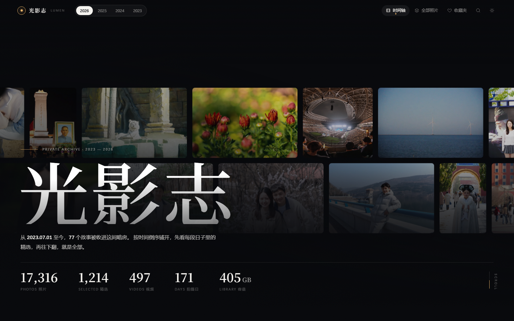
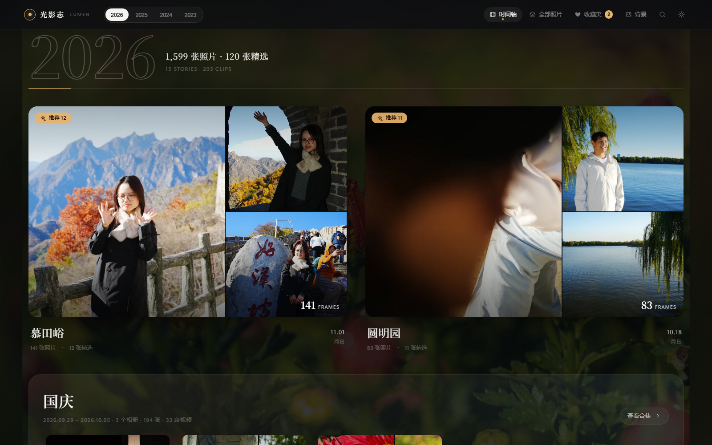
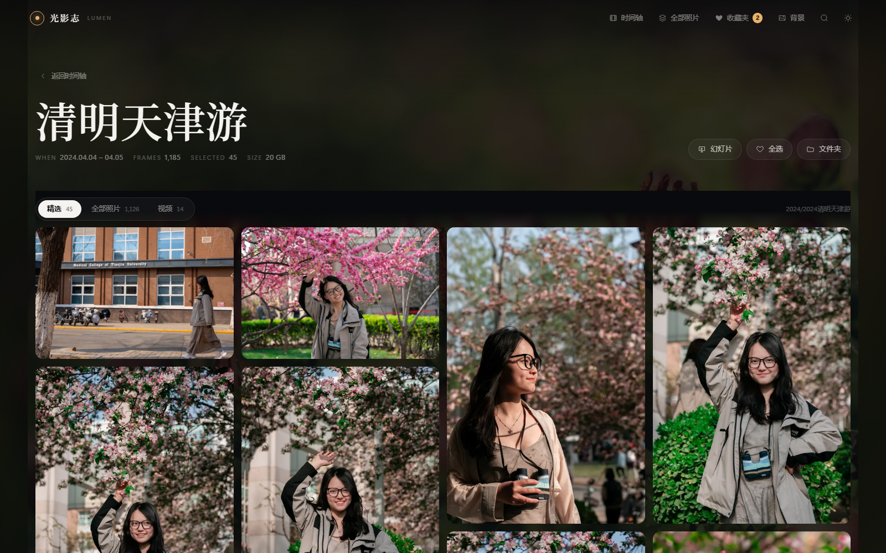
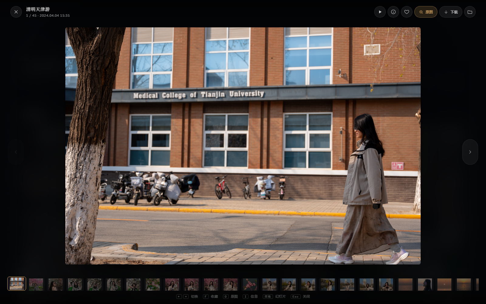
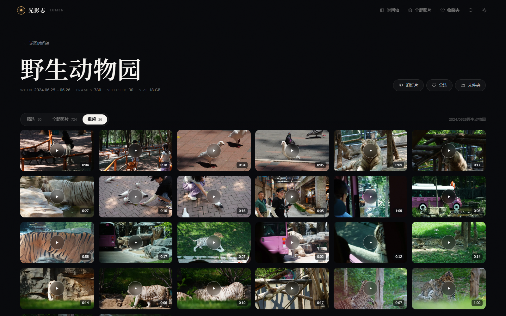
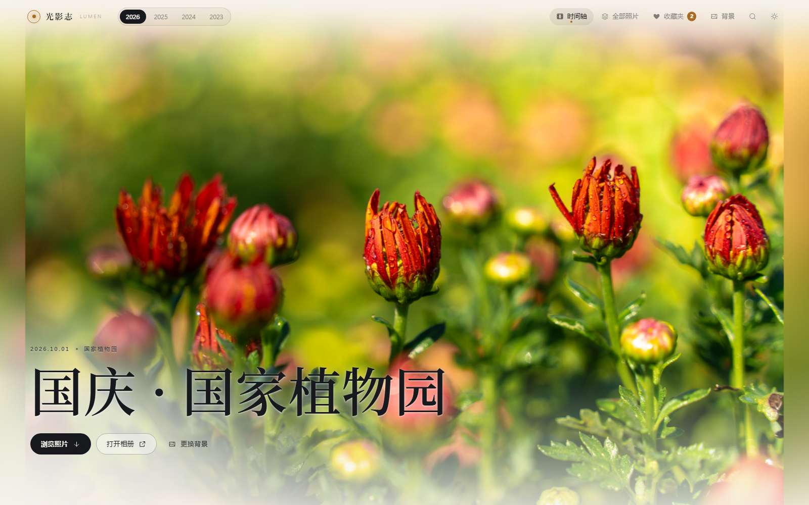
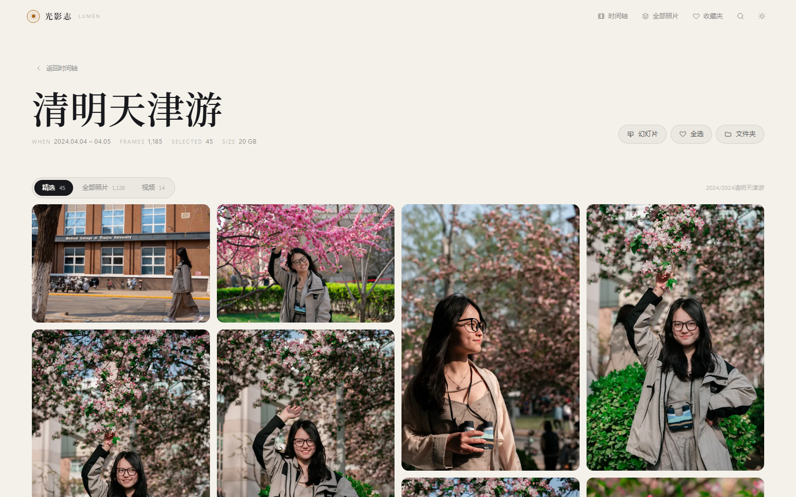
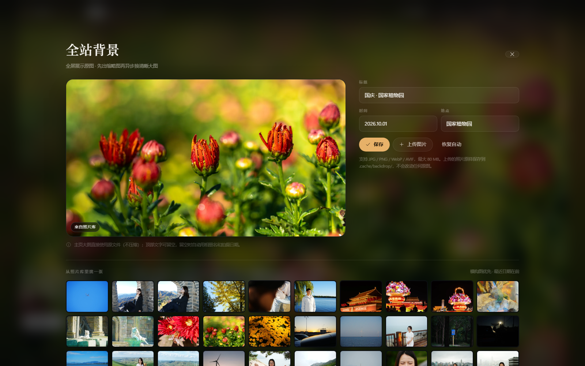
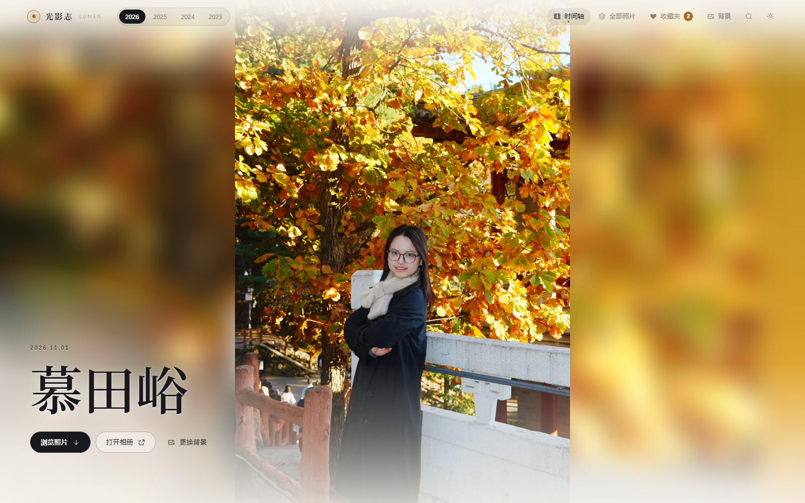
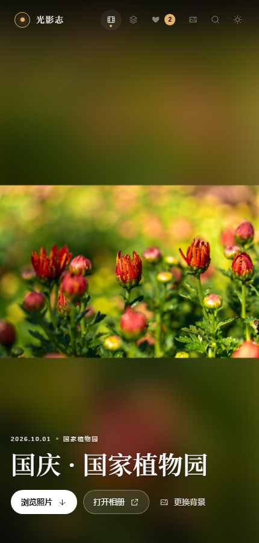

# 光影志 · Lumen

把 `E:\share\image` 里的日常照片，变成一个按时间铺开、可以慢慢翻、随手挑的本地相册网站。



| 时间轴 | 相册（精选） |
| --- | --- |
|  |  |

| 灯箱 | 视频 |
| --- | --- |
|  |  |

浅色（纸张）主题：

| 首页 | 相册 |
| --- | --- |
|  |  |

背景可以随时换（从照片库挑 / 上传原图 / 改文字）：



完整显示、不裁切：宽屏放竖图、手机放横图时，整张照片都会完整出现，四周用同一张图的模糊副本补齐。

| 宽屏 + 竖图 | 手机 + 横图 |
| --- | --- |
|  |  |

- **首页**：去掉照片轮播，改成整屏一张照片。左下角是「时间 · 地点」+ 大标题，下面只有「浏览照片 / 打开相册 / 更换背景」三个入口。
- **原图直出**：首页背景直接用原始文件（不压缩），按窗口完整比例显示、不裁切；四周空出来的地方用同一张图的模糊副本补齐，所以竖图、横图在大屏和手机上都能看到完整画面。
- **不阻塞首屏**：先内联一张 24px 的模糊占位图（LQIP），原图在后台异步下载，加载完淡入；页面从第一帧就能看。
- **全站背景**：同一张照片固定在所有页面后面；进入时间轴/相册后会盖一层纸色（浅色）或暗色（暗房）薄纱，既保留氛围又不影响读图。
- **自定义背景**：右上角「背景」、首页「更换背景」，或灯箱右上角的「设为背景」都能打开/直接应用。可以从照片库的横图里挑一张，也可以上传本机图片；标题/时间/地点留空时会自动用相册名和拍摄日期。上传的原图原样保存在 `.cache/backdrop/uploads/`，不写照片目录；「恢复自动」会回到最近相册的自动精选。
- **时间轴**：4 个年份（新的年份在上）→ 每段日子一张卡片（封面拼贴 + 精选数量）。**年内也按时间倒序**，整页从上到下就是"从新到旧"一条线。点进相册先看**精选**，再切「全部照片」；返回时回到你刚才点的那张卡片，而不是跳回顶部。
- **精选逻辑**：精选只算你自己留下的文件 —— `out/`（以及 `官方返图/`、`精修/`、`精选/`、`finals/`）和路径里带「精品放这里」的整组（比如 2023 旧存储）。没有精修的相册只会按时间均匀抽取一段「推荐」预览，单独标记，**不计入精选**。
- **相册内**：精选瀑布流 / 全部方形网格 / 视频分栏，滚动分页，1000+ 张也不卡。
- **大图**：灯箱支持键盘翻页、收藏、看参数、幻灯片、胶片条跳转、**查看原图**（切换到未压缩的原始像素，`O` 键切换）、**一键设为全站背景**（`B`）、下载原图、在资源管理器定位。图片上方有一条缩放条显示当前比例：滚轮以鼠标位置为中心在 **100%–800%** 之间缩放，放大后可以按住鼠标拖动平移，双击在「适应窗口」和 200% 之间切换，`+` / `-` / `0` 也可缩放和复位；手机上支持**双指缩放**、放大后单指拖动，缩放回 100% 后**左右滑动切换照片**（不会再触发浏览器的右滑返回）。
- **挑选**：每张图右上角的心，收藏后进「收藏夹」，可一键复制文件路径清单，方便后续导出。
- **全部照片**：跨相册的纯时间流，按月份分组，最新在前，可按年份筛；右上角「只看精选」一键切到全库精选流（只含上面这些真正的精选文件，不含自动推荐），年份筛选同样生效，按钮上直接显示当前年份的精选数量。
- **搜索**：相册名、地点、文件名都能搜（`/` 或 `Ctrl+K`）。
- **视频**：Sony `M4ROOT/CLIP` 的视频自动配对 `THMBNL` 封面，时长从 `MEDIAPRO.XML` 读取，可直接播放（支持拖动进度条）。没有相机封面的（无人机、旧 .mov）会在后台用 ffmpeg 截一帧存进 `.cache/posters`，下次启动直接复用；没有 ffmpeg 时改由浏览器在你打开相册时抓帧。
- **主题**：暗房（默认）/ 纸张两种，右上角切换；两套主题都是完整适配（首页大标题、渐变遮罩、搜索面板都会跟着变）。
- **隐私相册**：名字里带「证件照 / 身份证 / 护照」的相册默认不出现在时间轴和全部照片里，页脚有开关可以随时显示。

### 快捷键

| 键 | 作用 |
| --- | --- |
| `/` 或 `Ctrl+K` | 搜索 |
| `←` `→` | 灯箱里上一张 / 下一张 |
| `F` | 收藏当前照片 |
| `O` | 切换「查看原图」（原始像素） |
| `B` | 把当前照片设为全站背景 |
| `I` | 显示 / 隐藏参数面板 |
| `+` `-` | 灯箱里放大 / 缩小 |
| `0` | 缩放回适应窗口 |
| `空格` | 开始 / 暂停幻灯片 |
| `Esc` | 先复位缩放，再关闭灯箱 |

---

## 怎么跑起来

| 文件 | 作用 |
| --- | --- |
| **`start-bg.cmd`** | **后台启动（推荐）**：没有黑窗口，关掉命令行也继续跑，启动后自动打开浏览器 |
| `start.cmd` | 前台启动：留一个窗口，关掉窗口或 Ctrl+C 就停止 |
| `stop.cmd` | 停止后台服务 |
| `status.cmd` | 查看是否在跑、本机和局域网地址 |

首次运行会自动 `npm install` + 构建（几分钟）；之后都是秒开。

命令行等价写法：

```bash
npm install      # 首次
npm run build    # 构建前端到 dist/
npm start        # 前台启动（http://127.0.0.1:8787）
```

开发模式（前端热更新，Vite 代理到后端）：

```bash
npm run dev      # http://localhost:5173
```

### 局域网访问（手机 / 平板 / 另一台电脑）

服务默认绑定 `0.0.0.0`，启动时会把所有网卡地址打印出来，例如：

```
  ▸ my-gallery   http://127.0.0.1:8787
  ▸ LAN (以太网)  http://192.168.0.105:8787
```

手机连同一个 Wi-Fi，直接访问 `http://192.168.0.105:8787` 即可（页面是自适应的，手机上就是单列时间轴）。

打不开的话按顺序排查：

1. **防火墙**：本机已经有 node.exe 的「专用网络」入站放行规则，所以当前「以太网 = 专用网络」是可用的。如果换了网络被识别成「公用网络」，用管理员 PowerShell 执行一次：
   ```powershell
   New-NetFirewallRule -DisplayName "Lumen Gallery 8787" -Direction Inbound -Action Allow -Protocol TCP -LocalPort 8787 -Profile Private
   ```
2. **确认绑的是 0.0.0.0**：`status.cmd` 里能看到地址；若只看到 127.0.0.1，说明设置了 `HOST=127.0.0.1`。
3. 手机和电脑不在同一个网段（比如电脑连的是 VPN/虚拟网卡），换用打印出来的那个属于同一 Wi-Fi 的地址。

> 说明：这个站点没有登录验证，谁能访问这个端口谁就能看照片、改收藏。只在自己信得过的局域网里开着；不想暴露时设 `HOST=127.0.0.1` 重启即可。灯箱里的「在资源管理器中显示」只响应本机请求，局域网设备点了会被拒绝。

### 想开机自动后台运行

用「任务计划程序」建一个「登录时」触发的任务，操作填：

```
程序：   D:\project\my_gallery\start-bg.cmd
起始于： D:\project\my_gallery
```

（`start-bg.cmd` 已经有重复启动保护：已经在跑时不会起第二个，只打开浏览器。）

## 缩略图

原图平均 10–50 MB，网站用两档缓存：

| 产物 | 尺寸 | 用途 |
| --- | --- | --- |
| `.cache/thumbs/<key>_t.webp` | 长边 800 | 网格 / 封面 |
| `.cache/thumbs/<key>_b.webp` | 24px | 加载时的模糊占位 |
| `.cache/previews/<key>_p.webp` | 长边 1920 | 灯箱大图，首次查看时按需生成 |

- 全部落在项目目录的 `.cache/` 下（已 gitignore），**不会往照片目录写任何东西**。
- 网站启动后在后台异步生成，优先顺序：封面 → 精选 → 其余照片；顶部细进度条显示进度，**点它可以暂停后台生成**，浏览会更流畅（暂停时你正在看的图仍会立即生成）。
- 文件按「相对路径 + 大小 + 修改时间」做 key，改了/换了图会自动重新生成。
- 首次全量生成约 **40–70 分钟**（4 TB 机械盘、236 GB 照片，瓶颈是读盘）；期间可以正常浏览，缺的图会先显示模糊占位，滚到哪补到哪。生成完之后，全部缓存约 700 MB。

## 运行期间新增照片

服务内置了文件监听：

- 新增 / 删除 / 修改照片后约 2.5 秒自动重建索引，页面通过 SSE 自动刷新；
- 新照片会自动排进缩略图队列；
- 新增一个「日期+地点」文件夹也会直接变成一个时间轴节点（会用文件夹名里的 `0623`、`6月` 之类推断日期）。

## 相册是怎么识别的

按目录内容自动判断，不需要改任何命名习惯：

```
2024/0626野生动物园/
├── jpg/      普通照片        → 「全部照片」
├── out/      精修片          → 「精选」
├── raw/      RAW（忽略，不索引）
└── M4ROOT/CLIP/ + THMBNL/   视频 + 封面
```

- 有 `jpg/` `out/` `M4ROOT` 的算一个相册；只有子目录的算「合集」（如 `2023/旧存储`、`2026/国庆`），合集里每个子相册仍各自成卡片。
- 目录层级超过 2 层的会自动摊平到上一层，所以 `旧存储/精品放这里/百望山` 这种会归到「精品放这里」里（那一组默认全部当精选）。
- 日期优先取 EXIF 拍摄时间；`out/` 的 EXIF 往往是修图时间，所以会忽略它的时间，改为匹配原片。没有 EXIF 时退回文件名里的时间戳，再退回文件夹名里的 `0623`，最后才是文件修改时间。只有「复制时间」、没有真实拍摄时间的照片会归到所在相册的拍摄区间，不会因为拷贝/导出日期跑到别的年份。

关于 **2023**：`旧存储`、`精品放这里`、`证件照`、`好看的视频` 这些不规则目录都通过上面的通用规则处理成了正常卡片，没有写死特例。`证件照` 不会被用作首页背景的自动精选。

## 目录结构

```
server/
  index.mjs          HTTP 服务 / API / SSE / 文件监听
  config.mjs         路径、尺寸、并发等常量
  lib/scanner.mjs    扫描相册树
  lib/library.mjs    索引：EXIF、排序、精选、封面
  lib/thumbs.mjs     缩略图队列（sharp）
  lib/exif.mjs       EXIF 日期解析
  lib/backdrop.mjs   全站背景：自动挑选、LQIP、原图、上传
web/
  src/App.tsx        路由与全局状态
  src/Hero.tsx       首页：时间 / 地点 / 标题
  src/Backdrop.tsx   全站背景层 + 背景设置面板
  src/Timeline.tsx   年份 / 相册卡片
  src/Album.tsx      相册内页
  src/Lightbox.tsx   大图灯箱
  src/Overlays.tsx   启动页 / 搜索 / 全部照片 / 收藏夹
  src/styles.css     设计系统
.cache/              缩略图、索引、背景配置与上传（gitignore）
dist/                前端构建产物（gitignore）
```

## 可调项

用环境变量覆盖：

| 变量 | 默认 | 说明 |
| --- | --- | --- |
| `GALLERY_ROOT` | `E:\share\image` | 照片根目录 |
| `PORT` | `8787` | 端口 |
| `HOST` | `0.0.0.0` | 绑定地址；改成 `127.0.0.1` 就只允许本机访问 |
| `THUMB_CONCURRENCY` | `10` | 缩略图并行数（机械盘建议 8–12，SSD 可更高） |
| `SHARP_CONCURRENCY` | `1` | 单张解码线程数，保持 1 最快 |

## 备注

- 只读：服务只读取照片，不会修改、移动或删除任何原图。
- 背景设置存在 `.cache/backdrop.json`；上传的背景原图在 `.cache/backdrop/uploads/`（都随 `.cache` 一起被 gitignore）。
- 收藏记录存在 `.cache/selections.json`，随时可以「清空收藏夹」。
- 「复制清单」把选中照片的相对路径复制到剪贴板，方便丢给 Lightroom / 导出脚本。
